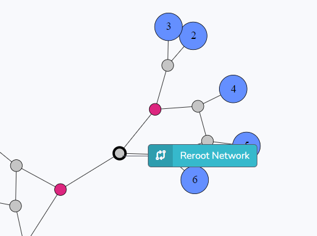

# phylo-knit

`phylo-knit` is a web application that allows biologists to visualize complex phylogenetics networks and quickly generate publication-ready visuals. 
Newick, triplet, and HyDe file formats are accepted.

---

## Running phylo-knit on your computer

phylo-knit has two parts: a Python server that does the computations (using
Julia and Java), and a web page that runs in your browser and sends your
input to that server.

### Requirements

- Python 3.9 or newer (tested with 3.11 and 3.14)
- Java, any version from 6 on; the `java` command must be on your PATH
- Julia does not need to be installed: on the first start, the server
  downloads it if needed, along with the PhyloNetworks package

### Install (once)

```bash
git clone https://github.com/solislemuslab/phylo-knit.git
cd phylo-knit
python3 -m venv .venv
.venv/bin/pip install -r requirements.txt
```

On Windows, use `.venv\Scripts\pip` and `.venv\Scripts\python` instead of
`.venv/bin/pip` and `.venv/bin/python`.

### Start the server

```bash
cd src/Server
../../.venv/bin/python Server.py
```

The first start takes a few minutes while Julia and PhyloNetworks are set
up; later starts are faster. Leave the server running while you use the page.
It listens at `http://127.0.0.1:5001`.

### Open the page

Once the server is running, go to <http://127.0.0.1:5001/> in your web
browser: the server also serves the page. (Opening the file
`src/Website/index.html` directly works too; the page then sends its
requests to the server at that same address.)

If the page says it could not reach the phylo-knit server, check that the
server from the previous step is still running. After updating the code,
reload the page with a hard reload (Cmd+Shift+R on macOS, Ctrl+Shift+R on
Windows and Linux) so the browser does not use old copies of its files.

---

## Basic Functionality

### __Create a network__

Under the `Inputs` tab, we accept extended Newick, triplets and `HyDe` formats, or you can choose from one of a few example extended Newick networks. Just upload your respective file or copy-paste your extended Newick and watch your network come to life!


### __Re-rooting the network__

After creating a network, click on the node that you want to make the new root. Click the button that appears and the re-rooted network will appear in just a few moments!



---

## Input Types

### Parenthetical/Newick
- Read about it [here](https://en.wikipedia.org/wiki/Newick_format).
- We support the original Newick tree format as well as the [extended Newick format](https://en.wikipedia.org/wiki/Newick_format#Extended_Newick).

### Triplets
- Triplets files [define trees](https://www.researchgate.net/publication/220586945_Constructing_Evolutionary_Trees_from_Rooted_Triples) and [level-1 networks](https://leovaniersel.files.wordpress.com/2014/09/practicallevel11.pdf) using relationships between sets of three taxa
- Each line in a triplets file is in the form of `leaf leaf2 leaf3 [weight]` where `[weight]` is optional.
- An [example](https://skelk.sdf-eu.org/lev1athan/example.trips) is provided by Lev1athan creators
- Read more under the section [LEV1ATHAN Basics](https://skelk.sdf-eu.org/lev1athan/)

### HyDe
- [HyDe](https://academic.oup.com/sysbio/article/67/5/821/4944070) output files can be used by LEV1ATHAN with internal conversion to triples files. The process and limitations are as follows:
  - As unfiltered HyDe results list all possible triples, it is necessary to input a $p$-value. Filtered HyDe results only output relationships that fall below the bonferroni-corrected $p$-value threshold, though further filtering below this $p$-value can also be performed.
  - Only hybrid relationships below the specified $p$-value will be converted to triples that specify hybrid relationships (that is, if P1 and P2 were putative parental lineages of hybrid `HYB`, we include triples `P1 HYB P2`, `HYB P2 P1`). For all other combinations of taxa that fall above the $p$-value threshold, we choose a single, arbitrary triple relationship per set of three taxa (that is, if P1 P2 and HYB had no hybrid relationship between them, we list triple `P1 P2 HYB` only once in the triple file, with no other permutations).
  - For this reason, **use of a backbone tree in Newick or extended Newick format is highly recommended**. Triples relationships extracted from the provided backbone tree or network are combined with the HyDe hybrid relationships' triples, avoiding the use of arbitrary sets of triples from a HyDe file.

## Contributions

Users interested in expanding functionalities of `phylo-knit` are welcome to do so. See details on how to contribute in [CONTRIBUTING.md](https://github.com/solislemuslab/phylo-knit/blob/master/CONTRIBUTING.md).

## Citations

* [LEV1ATHAN](https://skelk.sdf-eu.org/lev1athan/)

## License

Copyright (c) 2023 Solis-Lemus lab. phylo-knit is released under the [MIT License](LICENSE).
