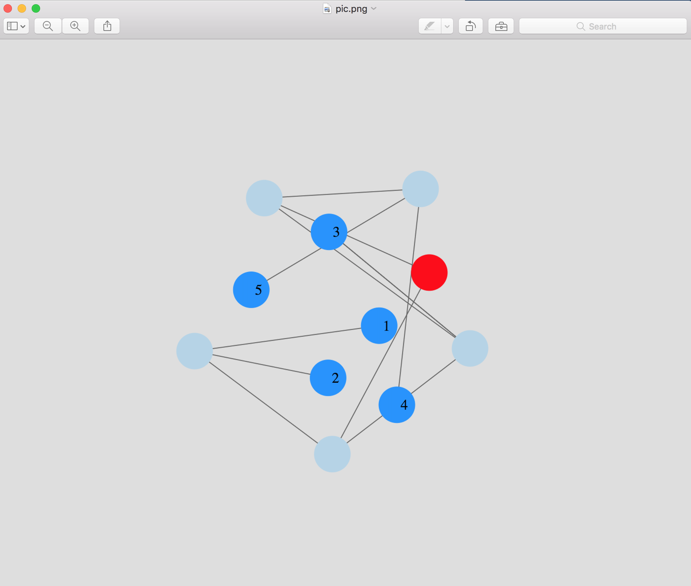
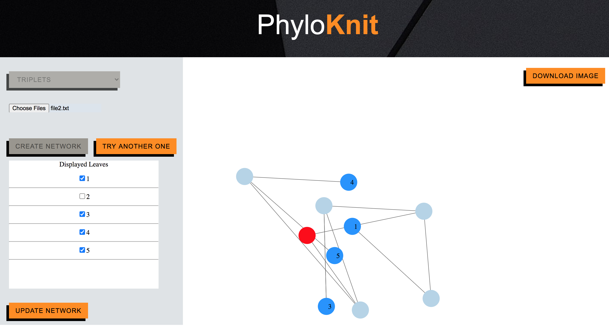

# PhyloKnit

**PhyloKnit** is a web application that allows biologists to visualize complex phylogenetics networks. 
Input can be accepted in different formats like Hyde, Parenthetical, Triplets, etc. 

* User can upload a certain type of inuput file and on clicking create network, the graph will be displayed.

* User can click on download image to save a screenshot of the displayed graph

* User can uncheck the nodes they want the delete from the graph. On clicking Update Network, a new graph is displayed with that node removed. 

## License

    Copyright [2020] [Ritika Mittal, Claudia Solis Lemus, Harnoor Singh, Naman Kanwar]

    Licensed under the Apache License, Version 2.0 (the "License");
    you may not use this file except in compliance with the License.
    You may obtain a copy of the License at

        http://www.apache.org/licenses/LICENSE-2.0

    Unless required by applicable law or agreed to in writing, software
    distributed under the License is distributed on an "AS IS" BASIS,
    WITHOUT WARRANTIES OR CONDITIONS OF ANY KIND, either express or implied.
    See the License for the specific language governing permissions and
    limitations under the License.
