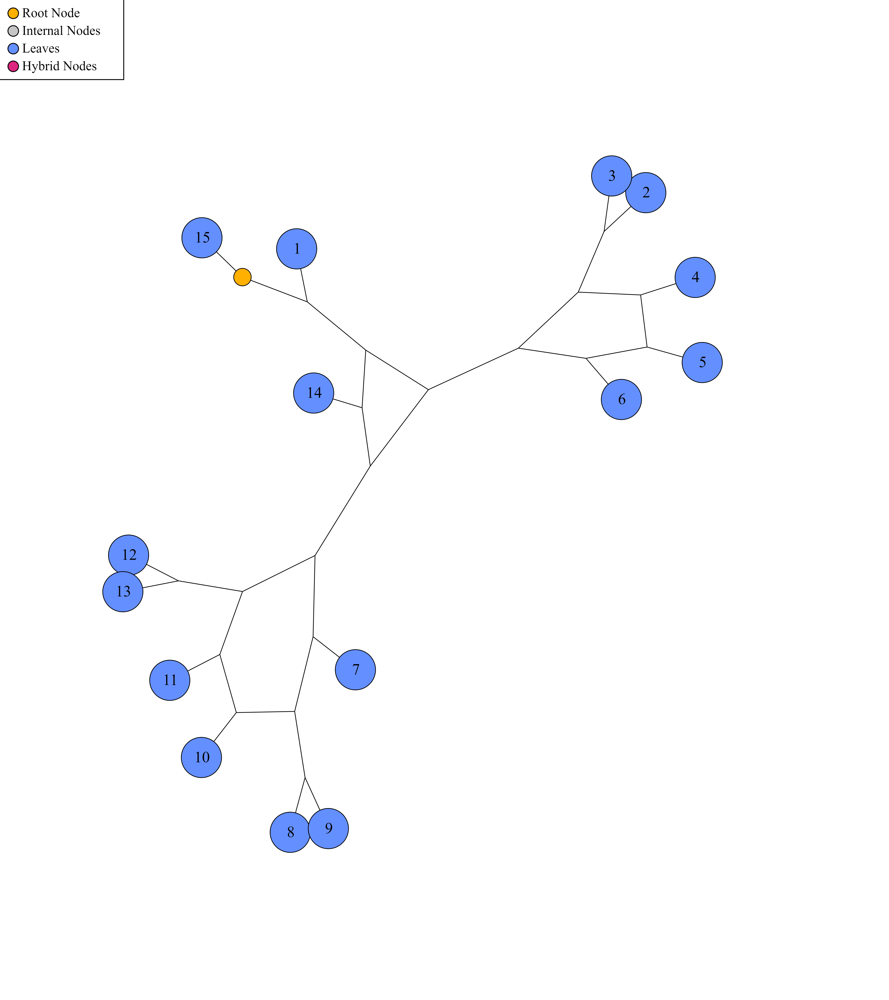

# phylo-knit

`phylo-knit` is a web application that allows biologists to visualize complex phylogenetics networks and quickly generate publication-ready visuals. 
Newick, triplet, and HyDe file formats are accepted.

## Basic Functionality

### __Create a network__

Under the `Inputs` tab, we accept extended Newick, triplets and `HyDe` formats, or you can choose from one of a few example extended Newick networks. Just upload your respective file or copy-paste your extended Newick and watch your network come to life!

### __Re-rooting the network__

After creating a network, click on the node that you want to make the new root. Click the button that appears and the re-rooted network will appear in just a few moments!

---

## FAQ

## Input Types

### Parenthetical/Newick
- Read about it [here](https://en.wikipedia.org/wiki/Newick_format).
- We support the original Newick tree format as well as the [extended Newick format](https://en.wikipedia.org/wiki/Newick_format#Extended_Newick).

### Triplets
- 

### HyDe
- make sure to note the $p$-value and backbone tree

## Visual options

## License

    Copyright [2023] Solis-Lemus lab

    Licensed under the Apache License, Version 2.0 (the "License");
    you may not use this file except in compliance with the License.
    You may obtain a copy of the License at

        http://www.apache.org/licenses/LICENSE-2.0

    Unless required by applicable law or agreed to in writing, software
    distributed under the License is distributed on an "AS IS" BASIS,
    WITHOUT WARRANTIES OR CONDITIONS OF ANY KIND, either express or implied.
    See the License for the specific language governing permissions and
    limitations under the License.
