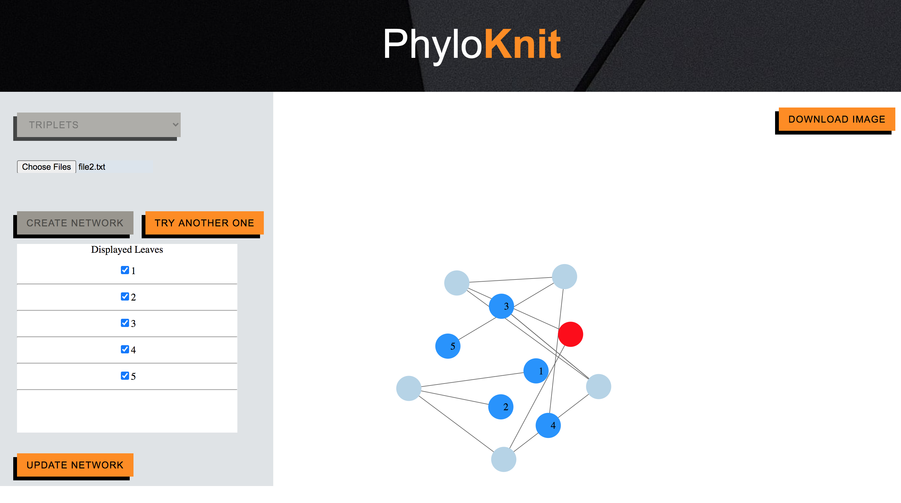

<!--
*** Thanks for checking out the Best-README-Template. If you have a suggestion
*** that would make this better, please fork the repo and create a pull request
*** or simply open an issue with the tag "enhancement".
*** Thanks again! Now go create something AMAZING! :D
-->


<!-- PROJECT SHIELDS -->
<!--
*** I'm using markdown "reference style" links for readability.
*** Reference links are enclosed in brackets [ ] instead of parentheses ( ).
*** See the bottom of this document for the declaration of the reference variables
*** for contributors-url, forks-url, etc. This is an optional, concise syntax you may use.
*** https://www.markdownguide.org/basic-syntax/#reference-style-links
-->


<!-- PROJECT LOGO -->


  <h3 align="center">Phylo-knit Developer Guide</h3>

  <p align="center">
    This is the developer guide for Phylo-knit Project
    <br />
</p>


<!-- TABLE OF CONTENTS -->
<details open="open">
  <summary>Table of Contents</summary>
  <ol>
    <li>
      <a href="#about-the-project">About The Project</a>
      <ul>
        <li><a href="#Requirements">Requirements</a></li>
      </ul>
    </li>
    <li>
      <a href="#getting-started">Getting Started</a>
      <ul>
        <li><a href="#Backend-Flow-Overview">Backend Summary</a></li>
        <li><a href="Frontend-Flow-Overview">Frontend Summary</a></li>
      </ul>
    </li>
    <li><a href="#Server">Server.py()</a></li>
    <li><a href="#ServerAction">ServerAction.py()</a></li>
    <!-- <li><a href="#contributing">Testing</a></li> -->
    <li><a href="#Sketch">Sketch.js</a></li>
    <li><a href="#Glossary">Glossary</a></li>
    <li><a href="#RoadMap">RoadMap/Flow</a></li>
  </ol>
</details>


<!-- ABOUT THE PROJECT -->
## About The Project

<!-- [![Product Name Screen Shot][product-screenshot]](https://example.com) -->

This is the developer guide for the Phylo-knit visualization project. This Project allows the visualization of phylogentic data in the form of the three formats (Hyde,Parenthetical and Triplet format). This guide allows a better udnerstanding of the project for any future developers and for myself to understanding the current level of the project




About:
* This Project is Flask based application. Uses python for file processing to generate dot files. 
* Dot files are then are used by sketch.js to create an interactive network.  

Of course, This is a very basic overview of the project and this guide will slowly ease you into being fully understanding and being able to work on this project. 


### Requirements

1. Install python3. To check try ```python3 --version```

2. Install pip3

3. Install python3 packages using pip3
* ```pip3 install -U flask-cors```
* ```pip3 install pydot```
* ```pip3 install pandas```
* ```pip3 install numpy```
* ```pip3 install flask```
* ```pip3 install ete3```

4. JRE 8 & JDK. To check try ```java --version``` or ```java -version```


<!-- GETTING STARTED -->
## Getting Started

1. Go to Server and Run the python script using ```python3 Server.py```

2. Navigate to phylo-knit/src/Website/, and open index.html. This should open a browser window with the website.

3. Try Entering a file format and using one of the files in Input files and see the visualization take place

## Backend Flow Overview

A basic understanding of get/post requests in Flask Applications might be needed. Here is overview of the backend:

* Sketch.js: Creates a XML request according to user enteries of file and sends the json to Server.py (Flask App) which will do all the handling and error checking

* Server.py: This file handles all the get/post requests from the user input and accordingly calls methods from the Serveraction.py file.

* ServerAction.py: This file handles all processing of the uplaoded documennt (the type of file is provided via a get call from Server.py) after the file type has been processed it is converted to a dot file using the jar file lev1thian.jar in the Server folder. Hyde and triplet Files are converted via the jar file where as server action has seperate methods for converting parenthical files to dot. Please see parentheticaltoDot() method for more info

* Lev1athan.jar : This file runs the levithan algorithim on our processed files (Triplet files) to create dot file. See cExample1.dot for an example on how a dot file would look.

* Note : Once ServerAction.py called methods end the post/get requests are also completed. The responses are sent back to the XML request caller to check 

## Frontend Flow Overview

The front-end html elements are located in index.html with most of the functionality in sketch.js and p5.js.

* Index.html: Holds most the elements such as buttons/text and options on the screen

* Style.css: main style sheet used for the html page.

* Sketch.js: Sends XML requests to the Flask app according to the file type chosen and does processing work such as creating the network visualization or create some level of error handing of user output. The important methods to check are PushHydeToServer(), TestUserInput(),OnClickCreateNetwork() and CreateD3Graph()


<!-- USAGE EXAMPLES -->
## Server

This covers the methods and main concepts in Server.py:

* Server.py is where the XML requests are processed. If you see each route method in this file reflects the request it is sent. For example if you run the applicaton and choose the Hyde format and input the file and the required threshold, the request recieved by the Flask application would be on the the '/uploadHyde/<thresh>' url. A good way to check this is to see the URL once you click the Create Network Button.

* Each request is handled accordingly by calling methods on ServerAction.py() depending on the request itself


<!-- ROADMAP -->
## ServerAction

* The main Goal of this file is to take the requested file and convert it into a dot file. See cExample1.dot for an example of how a dot file works.

* Triplet files: Triplet files are simply converted to Dot files by using the Lev1than.jar file which generates a dot file. The call to the method is done via Server.py request handlers. Check out TripletsToDot() to see how the the jar file is being called. 

* Hyde files: Is a little more complex but the idea is to convert the Hyde file to a triplet file and this is done via the method ParseHydeToTriplets() after that there is further processing to remove duplicate triplets 

* Parethetical: is the most complex conversion and requires a higher understanding of the file formats itself. First check parenthical.txt in Input files to get an idea of how the file formats look. Next check out the file ParentheticalToDot.py to understanding how the file syntax is being read and converted to a dot file.

* Error handling : Is done checking for either missing values, wrong formats or empty files. Currently what is occuring is when there is an error we are sending a json response with a status of 401 and a message back to the front-end which can be later displayed so that the user clearly understands what is going wrong with their file inputs. Check out the ParseHydeToTriplets() method to see how we check and return the error status and messages


## Sketch
The goal of this file is to take the user input from the front end and push the file as a request to server.py which handles the dot file processing. If the file formats were correct sketch.js then calls CreateD3Graph() which displays a visualization along with the colouring.

* CreateD3Graph(): The method is responsible for creating the visualization given a dot file. Although it is complex the main thing to understanding is how the node objects are being read and how the colours are being generated for the network
 
* Understanding the Network

1. Blue: Leaf Node
2. Grey: Inner nodes
3. Yellow: Hybrid nodes (a non-leaf node that consists of parents from  different tree branches)
4. Red: Root Node

* UserInputType(): This methods checks which option the user choose for file input. Method is essential to understanding the flow of how the application works and calls methods

* OnclickCreateNetwork(): Same as user input but in this case it calls methods such as PushParenthicalToServer() or PushHydeToServer() to create xmlrequests and process the files on the backend

* Push Hyde/Parenthetical/Triplet: You will see PushHydeToServer()/PushParenthicalToServer()/PushTripletToServer() as the main methods creating requests and waiting for a response of 200 (means it is good) I have also added methods to process to error handling messages on the status of 401 in case the file formats are wrong

* Testing: User inputs/errors are tested via TestUserInputMethod() on the file making sure users have added file/values they need to add without making unnecessary requests to the Flask app itself 
<!-- CONTRIBUTING -->
## Glossary


1. Hyde Files: See n10trial-out.txt/hyde15.txt in Input files to understand the formats of Hyde files each number on the parent and child refers to the node number

2. Triplet Files: See Triplet1.txt to understand this

3. Parenthetical: See parenthetical.txt to understand this. Make sure to try to dinguish how relationships look. Each comma seprates a sub tree/node from each other. This is also the same for newick formats

4. Root node: same as the root node for a binary tree it has no parents and is highlighted in red

5. Leaf node: ending nodes highlighted in blue it has no children and are the last nodes

6. Hybrid Nodes: Highlighted in yellow and are inner nodes that have two differnt non leaf nodes pointing towards it

7. Lev1than: algorithim used to create the dot files from triplets

8. Triplets: Set of the two parents and a child. Example " Parent : 2 Parent 3 Child: 4" this means that node 2 and 3 are parents to child node 4


<!-- LICENSE -->
<!-- ## License -->

<!-- Distributed under the MIT License. See `LICENSE` for more information. -->


<!-- CONTACT -->
## Contact

Project Link: [https://github.com/solislemuslab/phylo-knit](https://github.com/solislemuslab/phylo-knit)


## RoadMap


<!-- ACKNOWLEDGEMENTS -->
<!-- ## Acknowledgements
* [GitHub Emoji Cheat Sheet](https://www.webpagefx.com/tools/emoji-cheat-sheet)
* [Img Shields](https://shields.io)
* [Choose an Open Source License](https://choosealicense.com)
* [GitHub Pages](https://pages.github.com)
* [Animate.css](https://daneden.github.io/animate.css)
* [Loaders.css](https://connoratherton.com/loaders)
* [Slick Carousel](https://kenwheeler.github.io/slick)
* [Smooth Scroll](https://github.com/cferdinandi/smooth-scroll)
* [Sticky Kit](http://leafo.net/sticky-kit)
* [JVectorMap](http://jvectormap.com)
* [Font Awesome](https://fontawesome.com) -->


<!-- MARKDOWN LINKS & IMAGES -->
<!-- https://www.markdownguide.org/basic-syntax/#reference-style-links -->
<!-- [contributors-shield]: https://img.shields.io/github/contributors/othneildrew/Best-README-Template.svg?style=for-the-badge -->
<!-- [contributors-url]: https://github.com/othneildrew/Best-README-Template/graphs/contributors -->
<!-- [forks-shield]: https://img.shields.io/github/forks/othneildrew/Best-README-Template.svg?style=for-the-badge
[forks-url]: https://github.com/othneildrew/Best-README-Template/network/members
[stars-shield]: https://img.shields.io/github/stars/othneildrew/Best-README-Template.svg?style=for-the-badge
[stars-url]: https://github.com/othneildrew/Best-README-Template/stargazers
[issues-shield]: https://img.shields.io/github/issues/othneildrew/Best-README-Template.svg?style=for-the-badge
[issues-url]: https://github.com/othneildrew/Best-README-Template/issues
[license-shield]: https://img.shields.io/github/license/othneildrew/Best-README-Template.svg?style=for-the-badge
[license-url]: https://github.com/othneildrew/Best-README-Template/blob/master/LICENSE.txt
[linkedin-shield]: https://img.shields.io/badge/-LinkedIn-black.svg?style=for-the-badge&logo=linkedin&colorB=555
[linkedin-url]: https://linkedin.com/in/othneildrew -->
<!-- [product-screenshot]: images/screenshot.png -->
