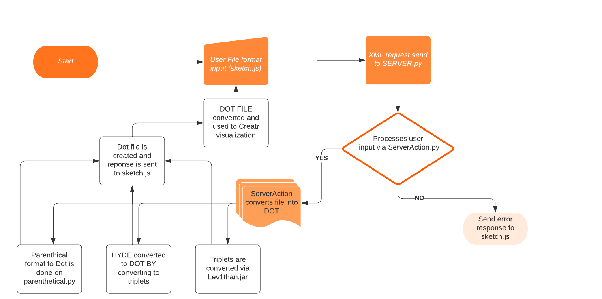

<!--
*** Thanks for checking out the Best-README-Template. If you have a suggestion
*** that would make this better, please fork the repo and create a pull request
*** or simply open an issue with the tag "enhancement".
*** Thanks again! Now go create something AMAZING! :D
-->


<!-- PROJECT SHIELDS -->
<!--
*** I'm using markdown "reference style" links for readability.
*** Reference links are enclosed in brackets [ ] instead of parentheses ( ).
*** See the bottom of this document for the declaration of the reference variables
*** for contributors-url, forks-url, etc. This is an optional, concise syntax you may use.
*** https://www.markdownguide.org/basic-syntax/#reference-style-links
-->


<!-- PROJECT LOGO -->


  <h3 align="center">Phylo-knit Developer Guide</h3>

  <p align="center">
    This is the developer guide for Phylo-knit Project
    <br />
</p>


<!-- TABLE OF CONTENTS -->
<details open="open">
  <summary>Table of Contents</summary>
  <ol>
    <li>
      <a href="#about-the-project">About The Project</a>
    </li>
    <li>
      <a href="#installation-instructions">Installation Instructions</a>
    </li>
    <li>
      <a href="#getting-started">Getting Started</a>
      <ul>
        <li><a href="#Backend-Flow-Overview">Backend Summary</a></li>
        <li><a href="Frontend-Flow-Overview">Frontend Summary</a></li>
      </ul>
    </li>
    <li><a href="#Server">Server.py()</a></li>
    <li><a href="#ServerAction">ServerAction.py()</a></li>
    <!-- <li><a href="#contributing">Testing</a></li> -->
    <li><a href="#Sketch">Sketch.js</a></li>
    <li><a href="#Glossary">Glossary</a></li>
    <li><a href="#RoadMap">RoadMap/Flow</a></li>
  </ol>
</details>


<!-- ABOUT THE PROJECT -->
## About The Project

<!-- [![Product Name Screen Shot][product-screenshot]](https://example.com) -->

This is the developer guide for the Phylo-knit visualization project. This Project allows the visualization of phylogentic data in the form of the three formats (Hyde,Parenthetical and Triplet format). This guide allows a better udnerstanding of the project for any future developers and for myself to understanding the current level of the project


About:
* This Project is Flask based application. It uses <code>Python</code> for server hosting, file processing, and dot files generation. It uses <code>Julia</code> for various phylogenetic functionalities provided in the <code>PhyloNetworks</code> package.
* Dot files are used by `sketch.js` to create an interactive network.  

This is a very basic overview of the project and this guide will slowly ease you into being fully understanding and being able to work on this project. 


## Installation Instructions

<a href="https://www.python.org/downloads/">`python3`, `pip3`</a>, <a href="https://www.java.com/en/download/">Java JRE 8</a> and <a href="https://www.oracle.com/java/technologies/downloads/">Java JDK</a> are required for installation. We used Python 3.9.6 and Julia 1.8.2.

```shell
# 1. Clone the repository
git clone https://github.com/solislemuslab/phylo-knit.git
cd phylo-knit

# 2. Install Python requirements
pip3 install -r requirements.txt

# 3. Install Julia requirements
julia
] add PhyloNetworks
exit()  # exit Julia

# 4. Install PyJulia
python3
>>> import julia
>>> julia.install()
>>> exit()  # exit Python

# 5. If Julia is not in your path, you will need to specify the Julia executable location on
#    line 9 of `phylo-knit/src/Server/Server.py`
```

For `PyJulia` troubleshooting help, visit https://pyjulia.readthedocs.io/en/latest/index.html.

Now you should be able to run the server with `python3 src/Server/Server.py`. After the server starts up, open the file `src/Website/index.html` in your web browser.

<!-- GETTING STARTED -->
## Getting Started

1. Go to `phylo-knit/src/Server` and Run the python script using `python3 Server.py`

2. Navigate to `phylo-knit/src/Website/`, and open `index.html` in your browser.

3. Try Entering a file format and using one of the files in Input files and see the visualization take place

## Backend Flow Overview

A basic understanding of GET/POST requests in Flask Applications might be needed. Here is overview of the backend:

* `sketch.js`: Creates an XML request according to the user's input and sends the json to `Server.py` (Flask App) which will do parsing, error checking, dot file generation, and other processing.

* `Server.py`: This file handles all the GET/POST requests from the user input and accordingly calls methods from the `Serveraction.py` file.

* `ServerAction.py`: This file handles all processing of the uploaded documennt (the type of file is provided via a GET call from Server.py) after the file type has been processed it is converted to a dot file using the jar file lev1thian.jar in the Server folder. Hyde and triplet Files are converted via the jar file where as server action has seperate methods for converting parenthical files to dot. Please see parentheticaltoDot() method for more info

* `Lev1athan.jar` : This file runs the lev1than algorithim on our processed files (Triplet files) to create a dot file. See `cExample1.dot` for an example on how a dot file would look.

* Note : Once ServerAction.py called methods end the GET/POST requests are also completed. The responses are sent back to the XML request caller to check 

## Frontend Flow Overview

The front-end html elements are located in index.html with most of the functionality in sketch.js and p5.js.

* `index.html`: Holds most the elements such as buttons/text and options on the screen

* `style.css`: The main style sheet used for the html page.

* `sketch.js`: Includes all front-end functionalities including functions that are linked to button presses, style adjustments, etc. Sets up the SVG that holds the network and builds the SVG elements whenever a new network is created. Calls functions from `request_helpers.js` whenever user input needs to be processed.

* `request_helpers.js`: Includes functions for sending input to the server and all download functionalities. Upon receiving a server response, this file either displays an error on the page or sends valid information to `sketch.js` to draw.


<!-- LICENSE -->
<!-- ## License -->

<!-- Distributed under the MIT License. See `LICENSE` for more information. -->


<!-- CONTACT -->
## Contact

Project Link: [https://github.com/solislemuslab/phylo-knit](https://github.com/solislemuslab/phylo-knit)


## RoadMap



<!-- ACKNOWLEDGEMENTS -->
<!-- ## Acknowledgements
* [GitHub Emoji Cheat Sheet](https://www.webpagefx.com/tools/emoji-cheat-sheet)
* [Img Shields](https://shields.io)
* [Choose an Open Source License](https://choosealicense.com)
* [GitHub Pages](https://pages.github.com)
* [Animate.css](https://daneden.github.io/animate.css)
* [Loaders.css](https://connoratherton.com/loaders)
* [Slick Carousel](https://kenwheeler.github.io/slick)
* [Smooth Scroll](https://github.com/cferdinandi/smooth-scroll)
* [Sticky Kit](http://leafo.net/sticky-kit)
* [JVectorMap](http://jvectormap.com)
* [Font Awesome](https://fontawesome.com) -->


<!-- MARKDOWN LINKS & IMAGES -->
<!-- https://www.markdownguide.org/basic-syntax/#reference-style-links -->
<!-- [contributors-shield]: https://img.shields.io/github/contributors/othneildrew/Best-README-Template.svg?style=for-the-badge -->
<!-- [contributors-url]: https://github.com/othneildrew/Best-README-Template/graphs/contributors -->
<!-- [forks-shield]: https://img.shields.io/github/forks/othneildrew/Best-README-Template.svg?style=for-the-badge
[forks-url]: https://github.com/othneildrew/Best-README-Template/network/members
[stars-shield]: https://img.shields.io/github/stars/othneildrew/Best-README-Template.svg?style=for-the-badge
[stars-url]: https://github.com/othneildrew/Best-README-Template/stargazers
[issues-shield]: https://img.shields.io/github/issues/othneildrew/Best-README-Template.svg?style=for-the-badge
[issues-url]: https://github.com/othneildrew/Best-README-Template/issues
[license-shield]: https://img.shields.io/github/license/othneildrew/Best-README-Template.svg?style=for-the-badge
[license-url]: https://github.com/othneildrew/Best-README-Template/blob/master/LICENSE.txt
[linkedin-shield]: https://img.shields.io/badge/-LinkedIn-black.svg?style=for-the-badge&logo=linkedin&colorB=555
[linkedin-url]: https://linkedin.com/in/othneildrew -->
<!-- [product-screenshot]: images/screenshot.png -->
